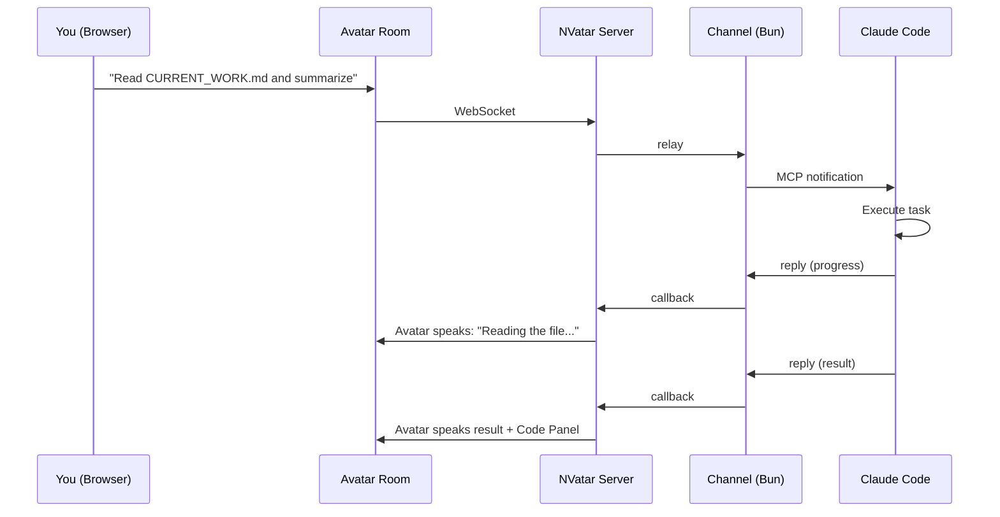
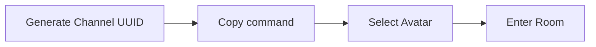
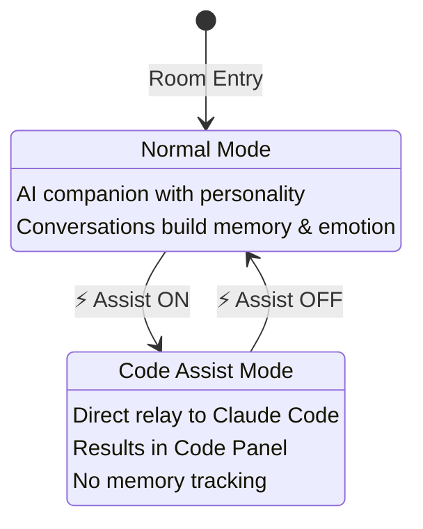
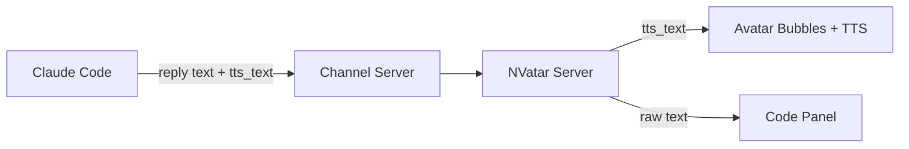
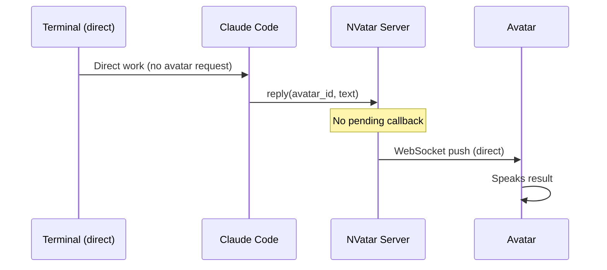
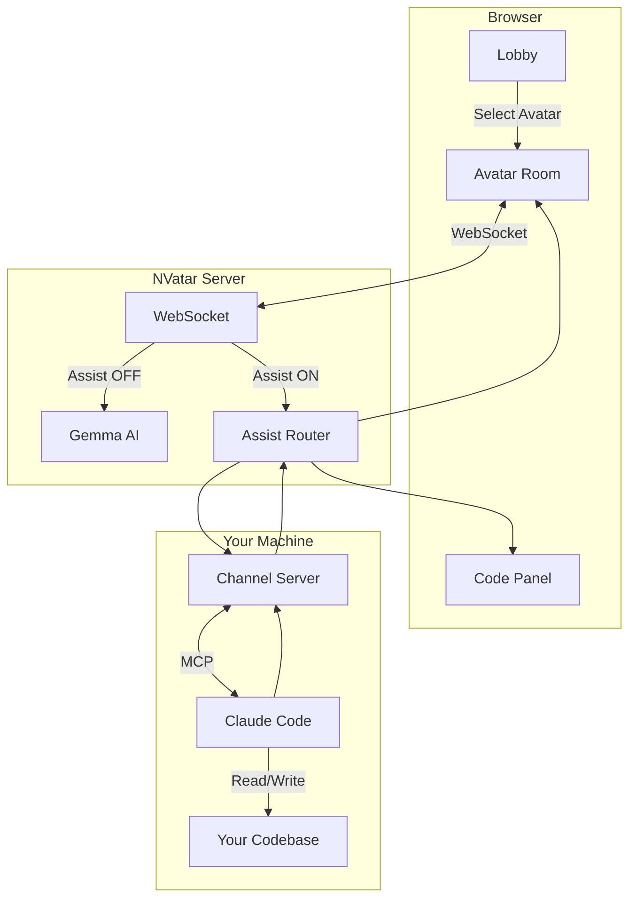
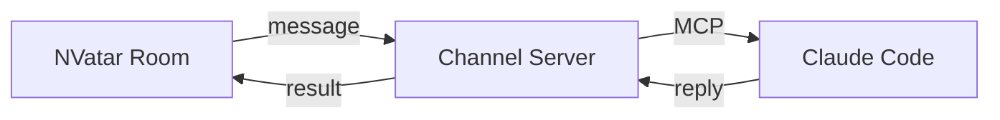

# NVatar Code Assist

> **Your 3D AI avatar becomes a code assistant — powered by Claude Code.**

NVatar Code Assist connects your [NVatar](https://github.com/nskit-io/nvatar-demo) avatar to a local [Claude Code](https://claude.ai/claude-code) session. Give code commands to your avatar, and Claude Code executes them on your machine.

[Live Demo (temporarily offline)](https://nskit-io.github.io/nvatar-code-assist/) · [한국어](docs/README_KO.md) · [日本語](docs/README_JA.md) · [中文](docs/README_ZH.md)

> **Note:** Live demo is temporarily offline while the demo server is under maintenance. You can still run it from source.
>
> **Security:** The hosted page is a **demo, not a production endpoint**. The NVatar server APIs it talks to have no user authentication and no avatar-ownership checks of their own. If you self-host, you must add authentication and server-side ownership checks yourself, and must not expose the server directly to the public internet. See [Security & Configuration](#security--configuration).

---

## How It Works



## Quick Start

### What You Need

- [Claude Code](https://claude.ai/claude-code) v2.1.80+
- [Bun](https://bun.sh/) runtime

### Step 1: Clone & Install

```bash
git clone https://github.com/nskit-io/nvatar-code-assist.git
cd nvatar-code-assist/channel
bun install
```

### Step 2: Open the Lobby

Visit **[https://nskit-io.github.io/nvatar-code-assist/](https://nskit-io.github.io/nvatar-code-assist/)**



1. Click **Gen** to generate a Channel UUID
2. Copy the terminal command shown below

### Step 3: Start Claude Code Channel

Paste the copied command in your terminal, adding the address of the NVatar server you use (the lobby shows only the UUID part):

```bash
NVATAR_SERVER_URL=https://your-nvatar-server.example.com \
NVATAR_CHANNEL_UUID=<your-uuid> \
claude --dangerously-load-development-channels server:nvatar
```

> **Important:** Start the channel BEFORE entering the room. Without `NVATAR_SERVER_URL` the channel cannot register (there is no default server). See [Channel configuration](#channel-configuration).

### Step 4: Enter Room & Toggle Assist

1. Select your avatar in the lobby and enter the room
2. Chat normally with your avatar first (greeting, set your name, etc.)
3. When ready for code work, click **⚡ Assist** in the toolbar
4. Give code commands — Claude Code executes them!

## Two Modes



### Normal Mode (default)

Your avatar is a conversational AI companion. It has personality, memory, emotions, and speaks with TTS. Daily conversations are saved and the avatar evolves over time.

### Code Assist Mode (⚡ toggle)

Messages relay to Claude Code asynchronously — **no timeout**. The avatar confirms delivery immediately, then results arrive when Claude Code finishes:

| Action | Behavior |
|--------|----------|
| Your message | Sent to Claude Code → avatar says "I've sent your request to Claude!" |
| Progress update | Avatar speaks it (real-time) |
| Final result | Avatar speaks TTS-friendly text + Code Panel shows raw data |
| Direct push | Claude Code can push results without avatar request |
| Ask avatar's opinion | Avatar responds with context |

> **Fire-and-forget**: No more timeout failures on long-running tasks. The server confirms POST delivery and returns immediately. Results arrive via async push — Claude Code takes as long as it needs.

**Opinion detection** works in 4 languages — ask your avatar what it thinks about the result:
- 🇰🇷 "어떻게 생각해?" · 🇺🇸 "What do you think?" · 🇯🇵 "どう思う?" · 🇨🇳 "你觉得怎么样?"

### Privacy

> **Code Assist mode does NOT save conversations to the avatar's memory.**

Code Assist results are stored in a separate Code Panel database, NOT in the avatar's Franchise Memory. This is controlled by `save_franchise_memory = false` — the pattern's default for sensitive data. Your code conversations never influence the avatar's personality or become part of its long-term recall.

| | Normal Mode | Code Assist Mode |
|---|---|---|
| Conversation log | Saved (builds personality) | Not saved |
| Emotion tracking | Active | Disabled |
| Franchise Memory | Accumulates over time | Disabled (`save_franchise_memory = false`) |
| Code results | — | Code Panel only (separate storage) |

When you toggle back to Normal Mode, your avatar continues from where you left off.

## TTS-Friendly Response Split

When Claude Code returns results containing tables, symbols, or formatted data, the response is split into two streams:



| Field | Purpose | Example |
|-------|---------|---------|
| `text` | Raw response with tables, code, symbols | `\| Plan \| Price \| ...` |
| `tts_text` | Natural spoken language for the avatar | "Starter is 5 dollars per month..." |

The avatar speaks the TTS-friendly version while the Code Panel displays the full raw data. If `tts_text` is omitted, the avatar reads the raw text as before (backward compatible).

## Server Push (Direct Push)

Claude Code can push results to the avatar **without a prior request**. When you work directly in the terminal and want the avatar to announce the result:



This enables a hybrid workflow: work directly in the terminal, and your avatar stays informed and announces results in real-time.

## Architecture

Code Assist is implemented as a `CodeAssistPattern` — one of several pluggable behaviors in the [NVatar SDK](https://github.com/nskit-io/nvatar-sdk) pattern system. The SDK's BehaviorPattern Registry routes messages to the correct pattern based on mode, so Code Assist runs independently from the avatar's personality engine.



The channel's HTTP listener binds to `127.0.0.1:8789`, so the NVatar server must be able to reach that address (run it on the same machine, or reach it through a tunnel you control).

## Claude Code Channel

This project uses **Claude Code Channels** — an MCP-based plugin system that lets external apps communicate with Claude Code.



The `channel/` directory contains the ready-to-use MCP server. Claude Code launches it automatically when you run the start command; the settings it reads are listed under [Channel configuration](#channel-configuration).

The channel server includes automatic retry (3 attempts, 2s intervals) for MCP notification delivery, ensuring messages reach Claude Code even during brief connection instability.

> For more on Claude Code Channels, see the [Claude Code documentation](https://docs.anthropic.com/en/docs/claude-code).

## Reliability

Code Assist includes multiple layers of retry and error handling:

| Layer | Behavior |
|-------|----------|
| **Channel → Claude Code** | MCP notification retry (3 attempts, 2s intervals) |
| **Server → Channel** | HTTP POST retry (2 attempts, 2s intervals) |
| **Delivery failure** | Simple error bubble — avatar does NOT generate a creative response about the failure |
| **TTS initialization** | `client_ready` handshake ensures TTS is initialized before avatar speaks |

When a message fails to reach Claude Code after retries, the avatar displays a plain error message instead of routing to the local AI (Gemma). This prevents confusing responses where the avatar "makes up" an answer to a code command.

## Security & Configuration

### Hosted demo vs. your own server

- The copy on GitHub Pages is wired to the project's demo server (`nvatar.nskit.io`, currently offline). It is a **demo only — not a production endpoint**. Do not send sensitive code or data through it.
- There is no server-URL override in the page (no `server` URL parameter). The lobby (`index.html`) is hard-wired to the demo server (`SERVER` / `RES_SERVER` constants); the room modules (`js/room/state.js`) use the demo server on `*.github.io` and their own origin elsewhere. To use your own NVatar server, serve these files from it and change the two constants in `index.html`.
- The NVatar server APIs have **no user authentication** and **no avatar-ownership check** of their own. Integrators must put authentication in front of every endpoint and verify on the server that the caller owns the avatar (`avatar` uid) and channel UUID they address.

### Channel configuration

The channel reads these environment variables (or lines in `~/.claude/channels/nvatar/.env`):

| Variable | Default | Description |
|----------|---------|-------------|
| `NVATAR_CHANNEL_UUID` | random | Must match the UUID generated in the lobby |
| `NVATAR_SERVER_URL` | none (placeholder) | Required. Your NVatar server; registration fails without it |
| `NVATAR_CHANNEL_SECRET` | random per start | Shared secret for the server-channel link. Set a fixed value to avoid a new secret on every restart |
| `NVATAR_CHANNEL_PORT` | `8789` | Local HTTP port (bound to `127.0.0.1`) |
| `NVATAR_STATE_DIR` | `~/.claude/channels/nvatar` | Where the `.env` file is read from |

### How the channel link is authenticated

1. At startup the channel registers with the NVatar server (`/api/v1/channel/register`), sending its channel secret (`X-Channel-Token` header and request body). It re-registers every 30 seconds as a heartbeat.
2. When the server relays a message to the channel (`POST /message` on `127.0.0.1:8789`), it must include that secret in the `token` field. A mismatch is rejected with **401**.
3. Callbacks from the channel to the server (`/api/v1/channel/callback`) carry the same `X-Channel-Token` header.

This secret only protects the server-channel link. It does **not** authenticate browser users and does not prove avatar ownership — that is the integrator's job (see above).

### CORS (only if the page and server are on different origins)

Served from your own server, the page is same-origin and needs no CORS. If you change the client to call a server on another origin, allow only your own origin(s) explicitly — never `*`:

```python
# FastAPI
app.add_middleware(CORSMiddleware,
    allow_origins=["https://your-username.github.io"],  # explicit allowlist, never "*"
    allow_methods=["GET", "POST"],
    allow_headers=["Content-Type", "Authorization"])
```

## Service & Limits

| Service | Notes |
|---------|-------|
| **NVatar Server** | The hosted demo server is temporarily offline (maintenance); it is a demo, not a production endpoint. Self-hosted servers must have authentication and ownership checks in front of them. |
| **TTS (Voice)** | Cloud TTS through the NVatar server. If TTS is unavailable, the avatar falls back to text bubbles. |
| **STT (Mic Input)** | Requires your own STT endpoint: set `window.NVATAR_WHISPER_URL` (e.g. `https://your-stt.example.com/api/v1/transcribe`). Without it the mic is disabled; text input always works. |

> For enterprise deployment with dedicated resources, [contact us](mailto:nskit@nskit.io).

## Troubleshooting

| Symptom | Fix |
|---------|-----|
| Delivery to the channel fails with 401 | The secret the server holds for this channel does not match the channel's current secret (e.g. the channel restarted with a new random secret before re-registering). Restart the channel (it re-registers at startup and every 30 s) and set a fixed `NVATAR_CHANNEL_SECRET` |
| Channel log: "NVATAR_SERVER_URL not set" | Set `NVATAR_SERVER_URL` to your NVatar server and restart the channel |
| Avatar doesn't relay commands | Click **⚡ Assist** to turn on Code Assist mode |
| "서버 연결 대기 중" | Refresh the page — server may be loading |
| Code panel empty after refresh | Make sure you're using the same Channel UUID |
| TTS not working | Browser autoplay policy — interact with the page first |
| Channel not connecting | Restart Claude Code with the same UUID and a valid `NVATAR_SERVER_URL` |
| Avatar doesn't move to center when speaking | Fixed — `returnToCenter()` is now called on every bubble event |
| Avatar speaks before TTS is ready | Fixed — `client_ready` handshake defers greeting until scene is loaded |
| Message delivery failed silently | Server now retries 2x with 2s interval; shows error on final failure |

## Project Structure

```
nvatar-code-assist/
├── index.html              # Lobby — avatar selection
├── code-assist.html        # Room — 3D avatar + chat + code panel
├── js/room/                # Room modules (16 files)
│   ├── main-assist.js      # Code assist toggle logic
│   ├── chat.js             # WebSocket + code panel
│   ├── i18n.js             # 4-language translations
│   └── ...                 # scene, animation, tts, stt, mood, etc.
├── vrm/
│   ├── models.json         # Avatar model list
│   └── thumbnails/         # Avatar thumbnails
├── channel/
│   ├── server.ts           # MCP channel server (Bun)
│   └── package.json
└── docs/                   # Translated READMEs (KO, JA, ZH)
```

## NVatarSDK API

For developers integrating with the room:

```javascript
// Subscribe to code results
NVatarSDK.onLookupResult = (data) => { ... };

// Read stored results
NVatarSDK.getLookupResults();
NVatarSDK.getUnreadCount();
NVatarSDK.clearLookupResults();
```

## Related Projects

| Project | Description |
|---------|-------------|
| [NVatar Demo](https://github.com/nskit-io/nvatar-demo) | AI 3D Avatar Chat Platform — the avatar runtime |
| [NVatar SDK](https://github.com/nskit-io/nvatar-sdk) | BehaviorPattern SDK — build pluggable avatar services |

## License

CC BY-NC-SA 4.0 — see [LICENSE](LICENSE)

> This repository publishes the design pattern and reference material under the MIT License. The NSKit framework itself (runtime, scaffolding, checkers and operating standards) is proprietary to Neoulsoft Inc. and available under a separate commercial license.

---

Built with [NVatar](https://github.com/nskit-io/nvatar-demo) and [NVatar SDK](https://github.com/nskit-io/nvatar-sdk) — AI 3D Avatar Chat Platform
