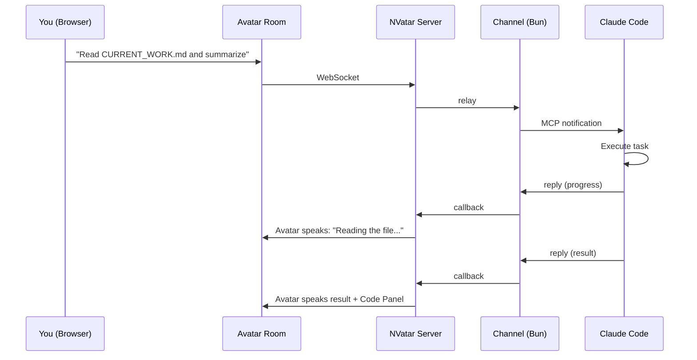
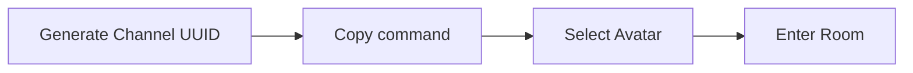
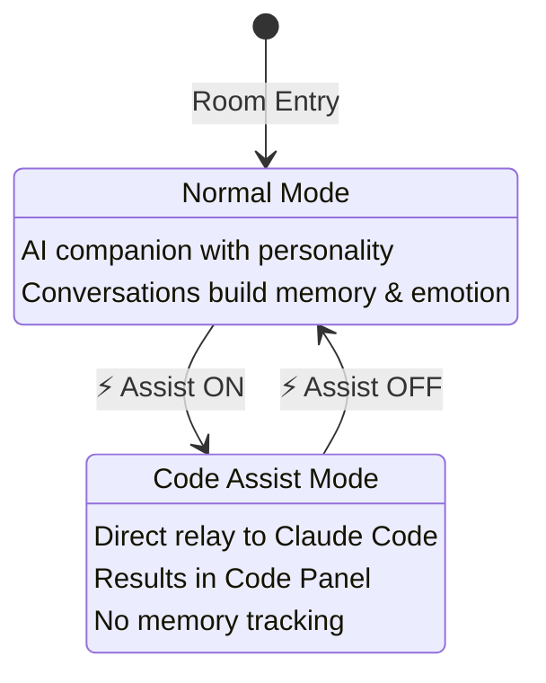
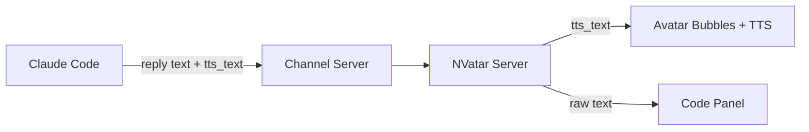
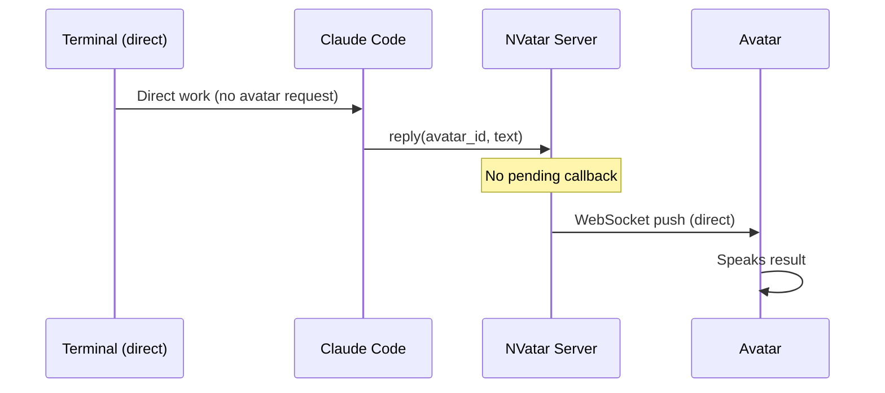
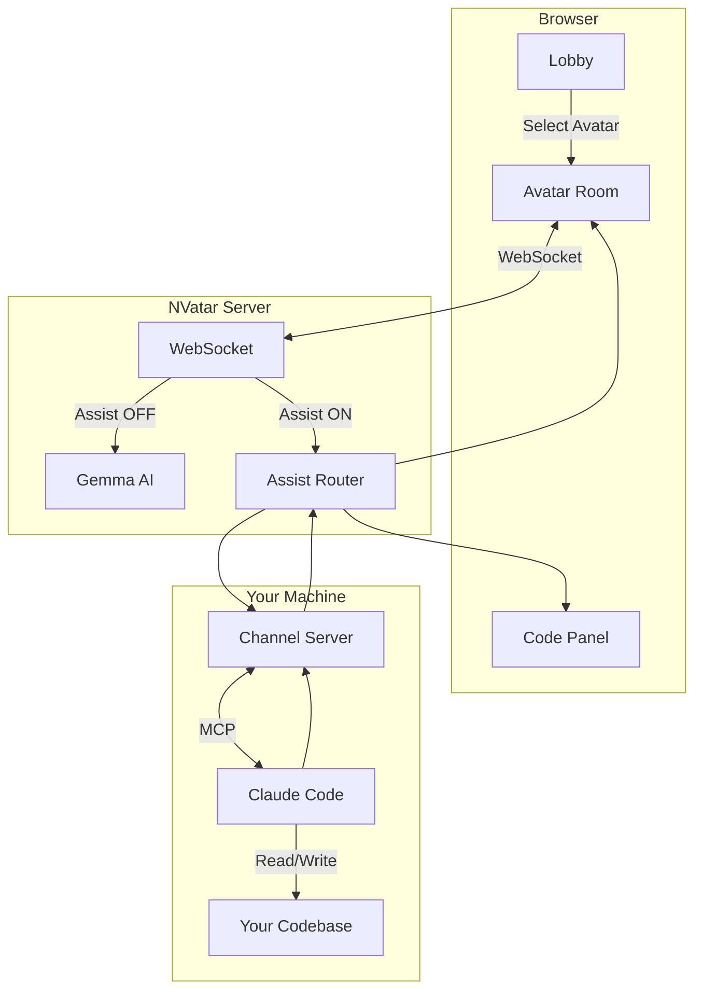
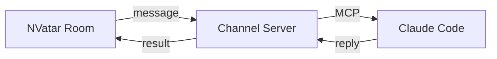

# NVatar Code Assist

> **3D AIアバターがコードアシスタントに -- Claude Code搭載。**

NVatar Code Assistは、[NVatar](https://github.com/nskit-io/nvatar-demo)のアバターをローカルの[Claude Code](https://claude.ai/claude-code)セッションと接続します。アバターにコードの指示を出すと、Claude Codeがあなたのマシン上で実行します。

[Live Demo（一時停止中）](https://nskit-io.github.io/nvatar-code-assist/) · [English](../README.md) · [한국어](README_KO.md) · [中文](README_ZH.md)

> **お知らせ:** デモサーバーのメンテナンスのため、ライブデモは一時停止中です。ソースからは引き続き実行できます。
>
> **セキュリティ:** ホストされたページは**デモであり、プロダクション用のエンドポイントではありません**。このページが呼び出す NVatar サーバー API には、独自のユーザー認証もアバター所有権の確認もありません。自前で運用する場合は、認証とサーバー側の所有権確認を自分で追加する必要があり、公開インターネットに直接さらしてはいけません。[セキュリティと設定](#セキュリティと設定)を参照。

---

## 仕組み



## クイックスタート

### 必要なもの

- [Claude Code](https://claude.ai/claude-code) v2.1.80以上
- [Bun](https://bun.sh/) ランタイム

### Step 1: クローンとインストール

```bash
git clone https://github.com/nskit-io/nvatar-code-assist.git
cd nvatar-code-assist/channel
bun install
```

### Step 2: ロビーを開く

**[https://nskit-io.github.io/nvatar-code-assist/](https://nskit-io.github.io/nvatar-code-assist/)** にアクセスします。



1. **Gen** をクリックして Channel UUID を生成します
2. 下に表示されるターミナルコマンドをコピーします

### Step 3: Claude Code チャンネルを開始

コピーしたコマンドに、使用する NVatar サーバーのアドレスを加えてターミナルで実行します(ロビーに表示されるのは UUID 部分のみです):

```bash
NVATAR_SERVER_URL=https://your-nvatar-server.example.com \
NVATAR_CHANNEL_UUID=<your-uuid> \
claude --dangerously-load-development-channels server:nvatar
```

> **重要:** ルームに入る前にチャンネルを開始してください。`NVATAR_SERVER_URL` がないとチャンネルは登録できません(デフォルトのサーバーはありません)。[チャンネル設定](#チャンネル設定)を参照。

### Step 4: ルームに入って Assist を切り替え

1. ロビーでアバターを選び、ルームに入ります
2. まずはアバターと普通に会話します(挨拶、名前の設定など)
3. コード作業の準備ができたら、ツールバーの **⚡ Assist** をクリックします
4. コードの指示を出すと Claude Code が実行します

## 2つのモード



### 通常モード(デフォルト)

アバターは対話型の AI コンパニオンです。性格・記憶・感情を持ち、TTS で話します。日常の会話は保存され、アバターは時間とともに進化します。

### コードアシストモード(⚡ トグル)

メッセージは Claude Code に非同期で中継されます — **タイムアウトなし**。アバターがすぐに受付を伝え、Claude Code が終わると結果が届きます:

| 操作 | 動作 |
|------|------|
| あなたのメッセージ | Claude Code へ送信 → アバターが「Claudeにお願いしたよ!」と案内 |
| 進捗の更新 | アバターがリアルタイムで話す |
| 最終結果 | アバターが TTS 向けテキストを話し、Code Panel に生データを表示 |
| ダイレクトプッシュ | Claude Code がアバターの依頼なしに結果を送信可能 |
| アバターの意見を聞く | アバターが結果の文脈を踏まえて応答 |

> **Fire-and-forget**: 長時間のタスクでもタイムアウトで失敗しません。サーバーは POST の受け渡しを確認してすぐに戻り、結果は非同期プッシュで届きます。Claude Code は必要なだけ時間をかけられます。

**意見の検出**は4言語に対応しています — 結果についてアバターの考えを聞いてみてください:
- 🇰🇷 "어떻게 생각해?" · 🇺🇸 "What do you think?" · 🇯🇵 "どう思う?" · 🇨🇳 "你觉得怎么样?"

### プライバシー

> **Code Assist モードでは、会話はアバターの記憶に保存されません。**

Code Assist の結果はアバターの Franchise Memory ではなく、別の Code Panel データベースに保存されます。これは機密データ向けのパターン既定値 `save_franchise_memory = false` で制御されます。コードの会話がアバターの性格に影響したり、長期記憶の一部になったりすることはありません。

| | 通常モード | Code Assist モード |
|---|---|---|
| 会話ログ | 保存(性格を形成) | 保存しない |
| 感情トラッキング | 有効 | 無効 |
| Franchise Memory | 時間とともに蓄積 | 無効(`save_franchise_memory = false`) |
| コード結果 | — | Code Panel のみ(別ストレージ) |

通常モードに戻ると、アバターは前回の続きから会話します。

## TTS 向けの応答分割

Claude Code が表・記号・書式付きデータを含む結果を返すと、応答は2つの流れに分かれます:



| フィールド | 用途 | 例 |
|-----------|------|-----|
| `text` | 表・コード・記号を含む生の応答 | `\| Plan \| Price \| ...` |
| `tts_text` | アバターが話す自然な文 | 「スターターは月5ドルで…」 |

アバターは TTS 向けの文を話し、Code Panel は生データをすべて表示します。`tts_text` がなければ、従来どおり生テキストを読み上げます(後方互換)。

## サーバープッシュ(ダイレクトプッシュ)

Claude Code は**事前の依頼なしに**アバターへ結果を送れます。ターミナルで直接作業し、その結果をアバターに知らせてほしいとき:



ターミナルで直接作業しながら、アバターが状況を把握して結果をリアルタイムで知らせる、ハイブリッドな作業スタイルが可能です。

## アーキテクチャ

Code Assist は `CodeAssistPattern` として実装されています — [NVatar SDK](https://github.com/nskit-io/nvatar-sdk) のパターンシステムにあるプラグイン型の振る舞いの1つです。SDK の BehaviorPattern Registry がモードに応じてメッセージを適切なパターンへ振り分けるため、Code Assist はアバターの性格エンジンから独立して動きます。



チャンネルの HTTP リスナーは `127.0.0.1:8789` にバインドされるため、NVatar サーバーがそのアドレスに到達できる必要があります(同じマシンで運用するか、自分で管理するトンネルを経由してください)。

## Claude Code チャンネル

このプロジェクトは **Claude Code Channels** を使います — 外部アプリが Claude Code と通信できるようにする、MCP ベースのプラグインシステムです。



`channel/` ディレクトリにすぐ使える MCP サーバーが入っています。開始コマンドを実行すると Claude Code が自動で起動し、チャンネルが読む設定は[チャンネル設定](#チャンネル設定)にまとめてあります。

チャンネルサーバーは MCP 通知の配信に自動リトライ(3回、2秒間隔)を備えており、接続が一時的に不安定でもメッセージが Claude Code に届きます。

> Claude Code Channels の詳細は [Claude Code ドキュメント](https://docs.anthropic.com/en/docs/claude-code)を参照してください。

## 信頼性

Code Assist には複数層のリトライとエラー処理があります:

| レイヤー | 動作 |
|---------|------|
| **チャンネル → Claude Code** | MCP 通知リトライ(3回、2秒間隔) |
| **サーバー → チャンネル** | HTTP POST リトライ(2回、2秒間隔) |
| **配信失敗** | シンプルなエラー吹き出し — アバターは失敗について創作した応答を返さない |
| **TTS 初期化** | `client_ready` ハンドシェイクで TTS 初期化後にアバターが話す |

リトライ後も Claude Code にメッセージが届かない場合、ローカル AI(Gemma)に回さず、シンプルなエラーメッセージを表示します。コードの指示にアバターが答えを「でっち上げる」混乱を防ぐためです。

## セキュリティと設定

### ホストされたデモと自前のサーバー

- GitHub Pages 上のページは、プロジェクトのデモサーバー(`nvatar.nskit.io`、現在一時停止中)を呼ぶよう固定されています。**デモ専用であり、プロダクション用のエンドポイントではありません。**機密のコードやデータを送らないでください。
- ページにはサーバー URL を切り替える手段(`server` URL パラメータ)がありません。ロビー(`index.html`)はデモサーバーに固定され(`SERVER` / `RES_SERVER` 定数)、ルームのモジュール(`js/room/state.js`)は `*.github.io` ではデモサーバーを、それ以外のホストでは自身の origin を使います。自前の NVatar サーバーを使うには、ファイルをそのサーバーから配信し、`index.html` の2つの定数を変更してください。
- NVatar サーバー API には独自の**ユーザー認証**も**アバター所有権の確認**もありません。連携する側がすべてのエンドポイントの前段に認証を置き、呼び出し元が指定したアバター(`avatar` uid)とチャンネル UUID の所有者であることをサーバー側で確認する必要があります。

### チャンネル設定

チャンネルは次の環境変数(または `~/.claude/channels/nvatar/.env` の行)を読みます:

| 変数 | デフォルト | 説明 |
|------|-----------|------|
| `NVATAR_CHANNEL_UUID` | ランダム | ロビーで生成した UUID と一致させる |
| `NVATAR_SERVER_URL` | なし(プレースホルダー) | 必須。使用する NVatar サーバー。ないと登録に失敗 |
| `NVATAR_CHANNEL_SECRET` | 起動ごとにランダム | サーバーとチャンネル間の共有シークレット。再起動のたびに変わらないよう固定値を推奨 |
| `NVATAR_CHANNEL_PORT` | `8789` | ローカル HTTP ポート(`127.0.0.1` にバインド) |
| `NVATAR_STATE_DIR` | `~/.claude/channels/nvatar` | `.env` ファイルを読む場所 |

### チャンネル接続の認証方式

1. チャンネルは起動時に NVatar サーバーへ登録し(`/api/v1/channel/register`)、チャンネルシークレットを送ります(`X-Channel-Token` ヘッダーとリクエスト本文)。以後30秒ごとにハートビートとして再登録します。
2. サーバーがチャンネルへメッセージを中継するとき(`127.0.0.1:8789` の `POST /message`)、`token` フィールドにそのシークレットを含める必要があります。一致しなければ **401** で拒否されます。
3. チャンネルからサーバーへのコールバック(`/api/v1/channel/callback`)にも同じ `X-Channel-Token` ヘッダーが付きます。

このシークレットが守るのはサーバーとチャンネル間の接続だけです。ブラウザーのユーザーを認証せず、アバターの所有権も証明しません — それは連携する側の役割です(上記参照)。

### CORS(ページとサーバーの origin が異なる場合のみ)

自前のサーバーからページを配信すれば同一 origin なので CORS は不要です。クライアントを別 origin のサーバーを呼ぶように変更する場合は、自分の origin だけを明示的に許可してください — `*` は不可:

```python
# FastAPI
app.add_middleware(CORSMiddleware,
    allow_origins=["https://your-username.github.io"],  # explicit allowlist, never "*"
    allow_methods=["GET", "POST"],
    allow_headers=["Content-Type", "Authorization"])
```

## サービスと制限

| サービス | 備考 |
|---------|------|
| **NVatar サーバー** | ホストされたデモサーバーはメンテナンスのため一時停止中で、デモであってプロダクション用のエンドポイントではありません。自前で運用するサーバーには前段に認証と所有権確認が必要です。 |
| **TTS(音声)** | NVatar サーバー経由のクラウド TTS。TTS が使えないときはテキストの吹き出しで動作します。 |
| **STT(マイク入力)** | 自前の STT エンドポイントが必要: `window.NVATAR_WHISPER_URL` を設定(例: `https://your-stt.example.com/api/v1/transcribe`)。未設定ならマイクは無効、テキスト入力は常に可能。 |

> 専用リソースが必要な企業導入は[お問い合わせください](mailto:nskit@nskit.io)。

## トラブルシューティング

| 症状 | 対処 |
|------|------|
| チャンネルへの配信が 401 で失敗 | サーバーが保持しているこのチャンネルのシークレットが、チャンネルの現在のシークレットと一致していません(例: チャンネルが新しいランダムのシークレットで再起動し、まだ再登録されていない)。チャンネルを再起動し(起動時と30秒ごとに再登録)、`NVATAR_CHANNEL_SECRET` を固定値にしてください |
| チャンネルのログ: "NVATAR_SERVER_URL not set" | `NVATAR_SERVER_URL` を NVatar サーバーのアドレスに設定し、チャンネルを再起動してください |
| アバターが指示を中継しない | **⚡ Assist** をクリックして Code Assist モードをオンにしてください |
| "서버 연결 대기 중"(サーバー接続待ち) | ページを再読み込みしてください — サーバーが読み込み中の可能性があります |
| 再読み込み後にコードパネルが空 | 同じ Channel UUID を使っているか確認してください |
| TTS が再生されない | ブラウザーの自動再生ポリシー — 先にページを操作してください |
| チャンネルがつながらない | 同じ UUID と正しい `NVATAR_SERVER_URL` で Claude Code を再起動してください |
| 話すときアバターが中央に戻らない | 修正済み — すべての吹き出しイベントで `returnToCenter()` が呼ばれます |
| TTS の準備前にアバターが話す | 修正済み — `client_ready` ハンドシェイクでシーンの読み込み後まで挨拶を遅らせます |
| メッセージ配信の失敗が気づかれない | サーバーが2秒間隔で2回リトライし、最終的に失敗したらエラーを表示します |

## プロジェクト構成

```
nvatar-code-assist/
├── index.html              # Lobby — アバター選択
├── code-assist.html        # Room — 3Dアバター + チャット + コードパネル
├── js/room/                # Room モジュール(16ファイル)
│   ├── main-assist.js      # コードアシストのトグル処理
│   ├── chat.js             # WebSocket + コードパネル
│   ├── i18n.js             # 4言語の翻訳
│   └── ...                 # scene, animation, tts, stt, mood など
├── vrm/
│   ├── models.json         # アバターモデル一覧
│   └── thumbnails/         # アバターのサムネイル
├── channel/
│   ├── server.ts           # MCP チャンネルサーバー(Bun)
│   └── package.json
└── docs/                   # 翻訳版 README(KO, JA, ZH)
```

## NVatarSDK API

ルームと連携する開発者向け:

```javascript
// Subscribe to code results
NVatarSDK.onLookupResult = (data) => { ... };

// Read stored results
NVatarSDK.getLookupResults();
NVatarSDK.getUnreadCount();
NVatarSDK.clearLookupResults();
```

## 関連プロジェクト

| プロジェクト | 説明 |
|------------|------|
| [NVatar Demo](https://github.com/nskit-io/nvatar-demo) | AI 3Dアバターチャットプラットフォーム — アバターのランタイム |
| [NVatar SDK](https://github.com/nskit-io/nvatar-sdk) | BehaviorPattern SDK — プラグイン型アバターサービスの開発 |

## ライセンス

CC BY-NC-SA 4.0 — [LICENSE](../LICENSE) を参照

---

Built with [NVatar](https://github.com/nskit-io/nvatar-demo) and [NVatar SDK](https://github.com/nskit-io/nvatar-sdk) — AI 3D Avatar Chat Platform
