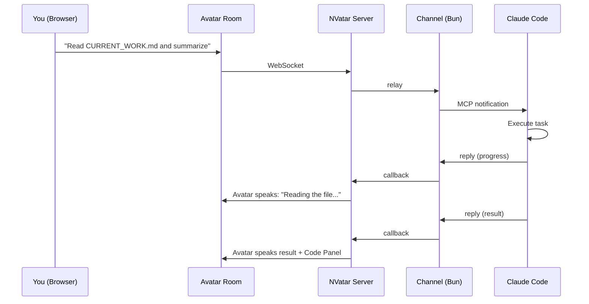
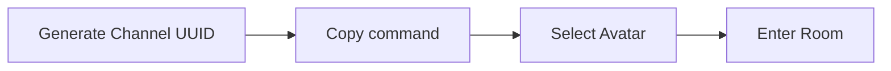
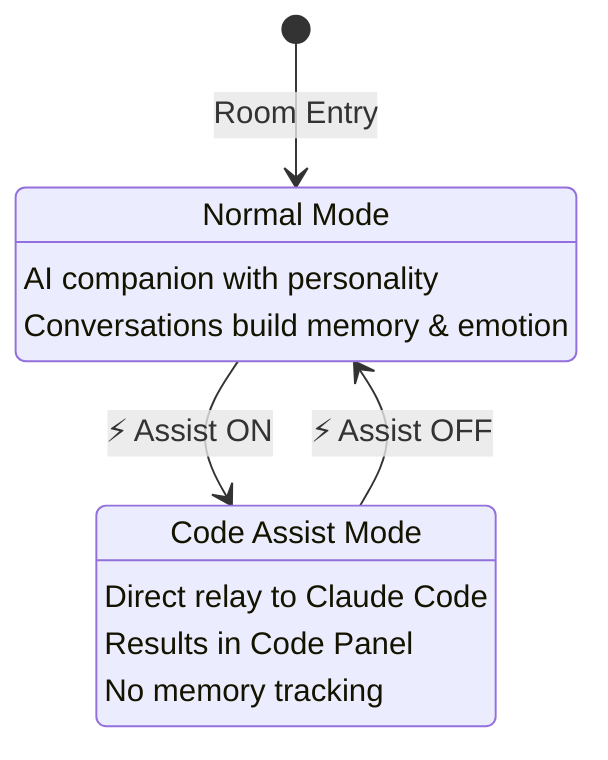
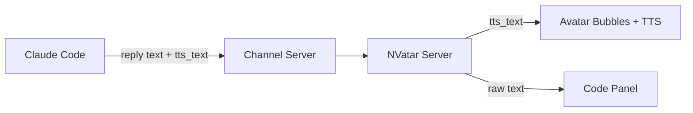
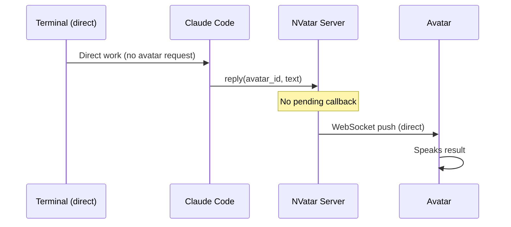
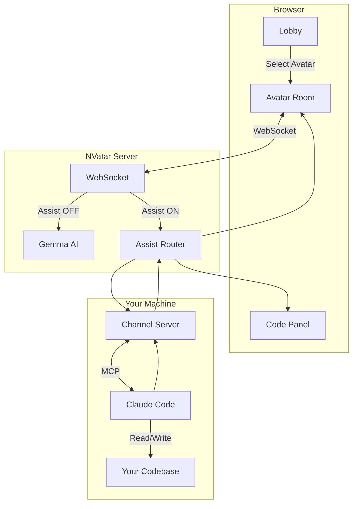
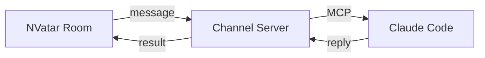

# NVatar Code Assist

> **3D AI 아바타가 코드 비서가 됩니다 -- Claude Code 기반.**

NVatar Code Assist는 [NVatar](https://github.com/nskit-io/nvatar-demo) 아바타를 로컬 [Claude Code](https://claude.ai/claude-code) 세션과 연결합니다. 아바타에게 코드 명령을 내리면, Claude Code가 여러분의 머신에서 실행합니다.

[Live Demo (일시 중단)](https://nskit-io.github.io/nvatar-code-assist/) · [English](../README.md) · [日本語](README_JA.md) · [中文](README_ZH.md)

> **안내:** 데모 서버 점검으로 라이브 데모가 일시 중단되었습니다. 소스에서 직접 실행할 수 있습니다.
>
> **보안:** 호스팅된 페이지는 **데모이며 프로덕션 엔드포인트가 아닙니다**. 이 페이지가 호출하는 NVatar 서버 API에는 자체 사용자 인증도, 아바타 소유권 확인도 없습니다. 직접 운영한다면 인증과 서버 측 소유권 확인을 직접 추가해야 하며, 공개 인터넷에 그대로 노출하면 안 됩니다. [보안 및 설정](#보안-및-설정) 참조.

---

## 동작 원리



## 빠른 시작

### 사전 준비

- [Claude Code](https://claude.ai/claude-code) v2.1.80 이상
- [Bun](https://bun.sh/) 런타임

### Step 1: 클론 및 설치

```bash
git clone https://github.com/nskit-io/nvatar-code-assist.git
cd nvatar-code-assist/channel
bun install
```

### Step 2: 로비 접속

**[https://nskit-io.github.io/nvatar-code-assist/](https://nskit-io.github.io/nvatar-code-assist/)** 에 접속합니다.



1. **Gen** 버튼을 클릭하여 Channel UUID를 생성합니다
2. 아래에 표시되는 터미널 명령어를 복사합니다

### Step 3: Claude Code 채널 시작

복사한 명령어에 사용할 NVatar 서버 주소를 더해 터미널에서 실행합니다(로비에는 UUID 부분만 표시됩니다):

```bash
NVATAR_SERVER_URL=https://your-nvatar-server.example.com \
NVATAR_CHANNEL_UUID=<your-uuid> \
claude --dangerously-load-development-channels server:nvatar
```

> **중요:** 룸에 입장하기 전에 채널을 먼저 시작하세요. `NVATAR_SERVER_URL` 이 없으면 채널이 등록되지 않습니다(기본 서버 없음). [채널 설정](#채널-설정) 참조.

### Step 4: 룸 입장 및 Assist 전환

1. 로비에서 아바타를 선택하고 룸에 입장합니다
2. 먼저 아바타와 일반 대화를 합니다 (인사, 이름 설정 등)
3. 코드 작업이 필요하면 툴바의 **⚡ Assist** 버튼을 클릭합니다
4. 코드 명령을 내리면 Claude Code가 실행합니다

## 두 가지 모드



### 일반 모드 (기본)

아바타는 대화형 AI 컴패니언입니다. 성격, 기억, 감정을 가지고 TTS로 말합니다. 일상 대화는 저장되고, 아바타는 시간이 지남에 따라 진화합니다.

### 코드 비서 모드 (⚡ 토글)

메시지가 Claude Code로 비동기 전달됩니다 — **타임아웃 없음**. 아바타가 접수를 바로 알려주고, Claude Code가 끝나면 결과가 도착합니다:

| 동작 | 처리 방식 |
|------|-----------|
| 사용자 메시지 | Claude Code로 전달 → 아바타가 "클로드에게 의뢰했어요!" 안내 |
| 진행 상황 업데이트 | 아바타가 실시간으로 말함 |
| 최종 결과 | 아바타가 TTS용 텍스트를 말하고, Code Panel에 원본 데이터 표시 |
| 다이렉트 푸시 | Claude Code가 아바타 요청 없이도 결과 전송 가능 |
| 아바타 의견 요청 | 아바타가 결과 컨텍스트와 함께 응답 |

> **Fire-and-forget**: 긴 작업에서도 타임아웃 실패가 없습니다. 서버는 POST 전달 확인 후 즉시 반환하고, 결과는 비동기 push로 도착합니다. Claude Code는 필요한 만큼 시간을 쓸 수 있습니다.

**의견 감지**는 4개 언어를 지원합니다 — 결과에 대해 아바타의 생각을 물어보세요:
- 🇰🇷 "어떻게 생각해?" · 🇺🇸 "What do you think?" · 🇯🇵 "どう思う?" · 🇨🇳 "你觉得怎么样?"

### 개인정보

> **Code Assist 모드에서는 대화 내용이 아바타 메모리에 저장되지 않습니다.**

Code Assist 결과는 아바타의 Franchise Memory가 아니라 별도의 Code Panel 데이터베이스에 저장됩니다. 이는 민감 데이터용 패턴 기본값인 `save_franchise_memory = false` 로 제어됩니다. 코드 대화는 아바타의 성격에 영향을 주지 않고 장기 기억의 일부가 되지 않습니다.

| | 일반 모드 | Code Assist 모드 |
|---|---|---|
| 대화 기록 | 저장 (성격 형성) | 저장하지 않음 |
| 감정 추적 | 활성 | 비활성 |
| Franchise Memory | 시간이 지나며 축적 | 비활성 (`save_franchise_memory = false`) |
| 코드 결과 | — | Code Panel 전용 (별도 저장소) |

일반 모드로 돌아오면 아바타는 이전 대화에서 이어갑니다.

## TTS 친화 응답 분리

Claude Code가 표·기호·서식 데이터를 담은 결과를 돌려주면, 응답이 두 갈래로 나뉩니다:



| 필드 | 용도 | 예시 |
|------|------|------|
| `text` | 표·코드·기호가 포함된 원본 응답 | `\| Plan \| Price \| ...` |
| `tts_text` | 아바타가 말할 자연스러운 문장 | "스타터는 월 5달러이고..." |

아바타는 TTS용 문장을 말하고, Code Panel은 원본 데이터를 모두 표시합니다. `tts_text` 가 없으면 기존처럼 원본 텍스트를 읽습니다(하위 호환).

## 서버 푸시 (다이렉트 푸시)

Claude Code는 **사전 요청 없이도** 아바타에게 결과를 보낼 수 있습니다. 터미널에서 직접 작업하고 그 결과를 아바타가 알려 주게 할 때:



터미널에서 직접 작업하면서도 아바타가 상황을 알고 결과를 실시간으로 알려 주는 하이브리드 작업 방식이 가능합니다.

## 아키텍처

Code Assist는 `CodeAssistPattern` 으로 구현되어 있습니다 — [NVatar SDK](https://github.com/nskit-io/nvatar-sdk) 패턴 시스템의 플러그인 동작 중 하나입니다. SDK의 BehaviorPattern Registry가 모드에 따라 메시지를 올바른 패턴으로 보내므로, Code Assist는 아바타의 성격 엔진과 독립적으로 동작합니다.



채널의 HTTP 리스너는 `127.0.0.1:8789` 에 바인딩되므로, NVatar 서버가 그 주소에 닿을 수 있어야 합니다(같은 머신에서 운영하거나, 직접 관리하는 터널을 거치십시오).

## Claude Code 채널

이 프로젝트는 **Claude Code Channel** 을 사용합니다 — 외부 앱이 Claude Code와 통신할 수 있게 해 주는 MCP 기반 플러그인 시스템입니다.



`channel/` 디렉토리에 바로 쓸 수 있는 MCP 서버가 들어 있습니다. 시작 명령을 실행하면 Claude Code가 자동으로 띄우며, 채널이 읽는 설정은 [채널 설정](#채널-설정)에 정리되어 있습니다.

채널 서버는 MCP 알림 전달에 자동 재시도(3회, 2초 간격)를 포함하므로, 연결이 잠시 불안정해도 메시지가 Claude Code에 도달합니다.

> Claude Code Channel에 대한 자세한 내용은 [Claude Code 문서](https://docs.anthropic.com/en/docs/claude-code)를 참고하세요.

## 안정성

Code Assist는 여러 계층의 재시도 및 오류 처리를 포함합니다:

| 계층 | 동작 |
|------|------|
| **채널 → Claude Code** | MCP 알림 재시도 (3회, 2초 간격) |
| **서버 → 채널** | HTTP POST 재시도 (2회, 2초 간격) |
| **전달 실패** | 단순 오류 말풍선 — 아바타가 실패에 대해 창작 응답을 만들지 않음 |
| **TTS 초기화** | `client_ready` 핸드셰이크로 TTS 초기화 후 아바타가 발화 |

재시도 후에도 Claude Code에 메시지가 전달되지 않으면, 로컬 AI(Gemma)로 라우팅하는 대신 단순 오류 메시지를 표시합니다. 아바타가 코드 명령에 대해 답을 "지어내는" 혼란을 막기 위해서입니다.

## 보안 및 설정

### 호스팅 데모와 직접 운영하는 서버

- GitHub Pages에 올라간 페이지는 프로젝트의 데모 서버(`nvatar.nskit.io`, 현재 일시 중단)를 호출하도록 고정되어 있습니다. **데모 전용이며 프로덕션 엔드포인트가 아닙니다.** 민감한 코드나 데이터를 보내지 마십시오.
- 페이지에는 서버 URL을 바꾸는 방법(`server` URL 파라미터)이 없습니다. 로비(`index.html`)는 데모 서버로 고정되어 있고(`SERVER` / `RES_SERVER` 상수), 룸 모듈(`js/room/state.js`)은 `*.github.io` 에서는 데모 서버를, 그 밖의 호스트에서는 자기 origin을 씁니다. 직접 운영하는 NVatar 서버를 쓰려면 파일을 그 서버에서 서빙하고 `index.html` 의 두 상수를 바꾸십시오.
- NVatar 서버 API에는 자체 **사용자 인증**도, **아바타 소유권 확인**도 없습니다. 연동하는 쪽이 모든 엔드포인트 앞에 인증을 두고, 호출자가 지정한 아바타(`avatar` uid)와 채널 UUID의 소유자인지 서버에서 확인해야 합니다.

### 채널 설정

채널은 다음 환경 변수(또는 `~/.claude/channels/nvatar/.env` 의 줄)를 읽습니다:

| 변수 | 기본값 | 설명 |
|------|--------|------|
| `NVATAR_CHANNEL_UUID` | 무작위 | 로비에서 생성한 UUID와 일치해야 함 |
| `NVATAR_SERVER_URL` | 없음 (플레이스홀더) | 필수. 사용할 NVatar 서버. 없으면 등록 실패 |
| `NVATAR_CHANNEL_SECRET` | 시작할 때마다 무작위 | 서버-채널 연결의 공유 비밀값. 재시작마다 새 값이 생기지 않도록 고정값 권장 |
| `NVATAR_CHANNEL_PORT` | `8789` | 로컬 HTTP 포트 (`127.0.0.1` 바인딩) |
| `NVATAR_STATE_DIR` | `~/.claude/channels/nvatar` | `.env` 파일을 읽는 위치 |

### 채널 연결의 인증 방식

1. 채널은 시작할 때 NVatar 서버에 등록하면서(`/api/v1/channel/register`) 채널 비밀값을 보냅니다(`X-Channel-Token` 헤더와 요청 본문). 이후 30초마다 하트비트로 재등록합니다.
2. 서버가 채널로 메시지를 전달할 때(`127.0.0.1:8789` 의 `POST /message`) `token` 필드에 그 비밀값을 넣어야 합니다. 일치하지 않으면 **401**로 거부합니다.
3. 채널이 서버로 보내는 콜백(`/api/v1/channel/callback`)에도 같은 `X-Channel-Token` 헤더가 붙습니다.

이 비밀값은 서버-채널 연결만 보호합니다. 브라우저 사용자를 인증하지 않으며 아바타 소유권도 증명하지 않습니다 — 그것은 연동하는 쪽의 몫입니다(위 참조).

### CORS (페이지와 서버의 origin이 다를 때만)

직접 운영하는 서버에서 페이지를 서빙하면 같은 origin이라 CORS가 필요 없습니다. 클라이언트가 다른 origin의 서버를 호출하도록 바꾼다면, 본인 origin만 명시적으로 허용하십시오 — `*` 는 금지:

```python
# FastAPI
app.add_middleware(CORSMiddleware,
    allow_origins=["https://your-username.github.io"],  # explicit allowlist, never "*"
    allow_methods=["GET", "POST"],
    allow_headers=["Content-Type", "Authorization"])
```

## 서비스 제한

| 서비스 | 비고 |
|--------|------|
| **NVatar 서버** | 호스팅 데모 서버는 점검으로 일시 중단 중이며, 데모일 뿐 프로덕션 엔드포인트가 아닙니다. 직접 운영하는 서버는 앞단에 인증과 소유권 확인이 필요합니다. |
| **TTS (음성)** | NVatar 서버 경유 클라우드 TTS. TTS를 쓸 수 없으면 텍스트 말풍선으로 동작합니다. |
| **STT (마이크 입력)** | 직접 준비한 STT 엔드포인트 필요: `window.NVATAR_WHISPER_URL` 지정 (예: `https://your-stt.example.com/api/v1/transcribe`). 없으면 마이크 비활성, 텍스트 입력은 항상 가능. |

> 전용 리소스가 필요한 기업 도입은 [문의해 주세요](mailto:nskit@nskit.io).

## 문제 해결

| 증상 | 해결 방법 |
|------|-----------|
| 채널 전달이 401로 실패 | 서버가 가진 이 채널의 비밀값이 채널의 현재 비밀값과 다릅니다(예: 채널이 새 무작위 비밀값으로 재시작했는데 아직 재등록 전). 채널을 재시작하고(시작 시와 30초마다 재등록), `NVATAR_CHANNEL_SECRET` 을 고정값으로 지정하세요 |
| 채널 로그: "NVATAR_SERVER_URL not set" | `NVATAR_SERVER_URL` 을 NVatar 서버 주소로 지정하고 채널을 재시작하세요 |
| 아바타가 명령을 전달하지 않음 | **⚡ Assist** 를 눌러 Code Assist 모드를 켜세요 |
| "서버 연결 대기 중" | 페이지를 새로고침하세요 — 서버가 로딩 중일 수 있습니다 |
| 새로고침 후 코드 패널이 비어 있음 | 같은 Channel UUID를 쓰고 있는지 확인하세요 |
| TTS가 재생되지 않음 | 브라우저 자동 재생 정책 — 먼저 페이지와 상호작용하세요 |
| 채널이 연결되지 않음 | 같은 UUID와 올바른 `NVATAR_SERVER_URL` 로 Claude Code를 재시작하세요 |
| 아바타가 발화 시 중앙으로 이동하지 않음 | 수정 완료 — 모든 말풍선 이벤트에서 `returnToCenter()` 가 호출됩니다 |
| TTS 준비 전에 아바타가 말함 | 수정 완료 — `client_ready` 핸드셰이크로 씬 로딩 후 인사를 지연합니다 |
| 메시지 전달 실패가 조용히 발생함 | 서버가 2초 간격으로 2회 재시도하고, 최종 실패 시 오류를 표시합니다 |

## 프로젝트 구조

```
nvatar-code-assist/
├── index.html              # Lobby — 아바타 선택
├── code-assist.html        # Room — 3D 아바타 + 채팅 + 코드 패널
├── js/room/                # Room 모듈 (16개 파일)
│   ├── main-assist.js      # 코드 비서 토글 로직
│   ├── chat.js             # WebSocket + 코드 패널
│   ├── i18n.js             # 4개 언어 번역
│   └── ...                 # scene, animation, tts, stt, mood 등
├── vrm/
│   ├── models.json         # 아바타 모델 목록
│   └── thumbnails/         # 아바타 썸네일
├── channel/
│   ├── server.ts           # MCP 채널 서버 (Bun)
│   └── package.json
└── docs/                   # 번역 README (KO, JA, ZH)
```

## NVatarSDK API

룸과 연동하는 개발자용:

```javascript
// Subscribe to code results
NVatarSDK.onLookupResult = (data) => { ... };

// Read stored results
NVatarSDK.getLookupResults();
NVatarSDK.getUnreadCount();
NVatarSDK.clearLookupResults();
```

## 관련 프로젝트

| 프로젝트 | 설명 |
|---------|------|
| [NVatar Demo](https://github.com/nskit-io/nvatar-demo) | AI 3D 아바타 채팅 플랫폼 — 아바타 런타임 |
| [NVatar SDK](https://github.com/nskit-io/nvatar-sdk) | BehaviorPattern SDK — 플러그인형 아바타 서비스 개발 |

## 라이선스

CC BY-NC-SA 4.0 — [LICENSE](../LICENSE) 참조

---

Built with [NVatar](https://github.com/nskit-io/nvatar-demo) and [NVatar SDK](https://github.com/nskit-io/nvatar-sdk) — AI 3D Avatar Chat Platform
