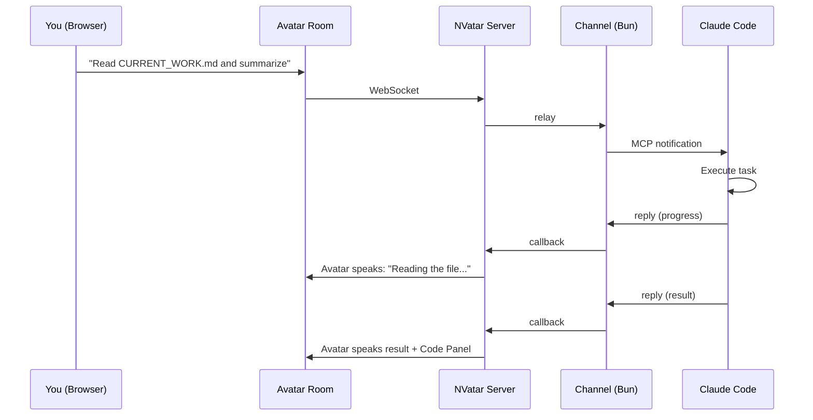
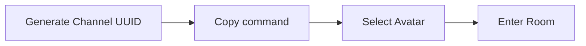
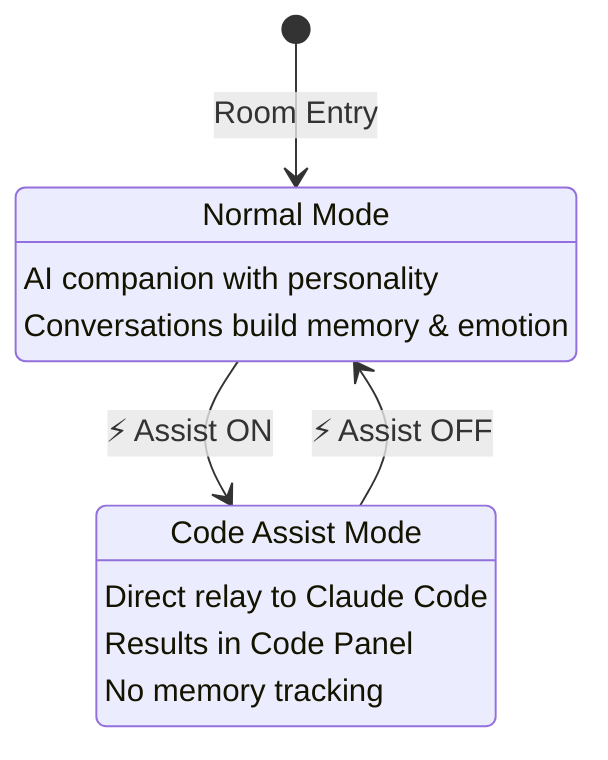
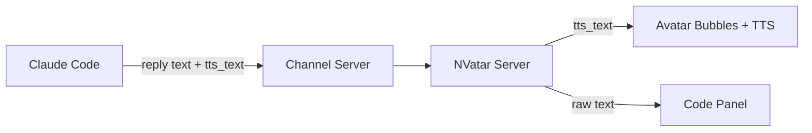
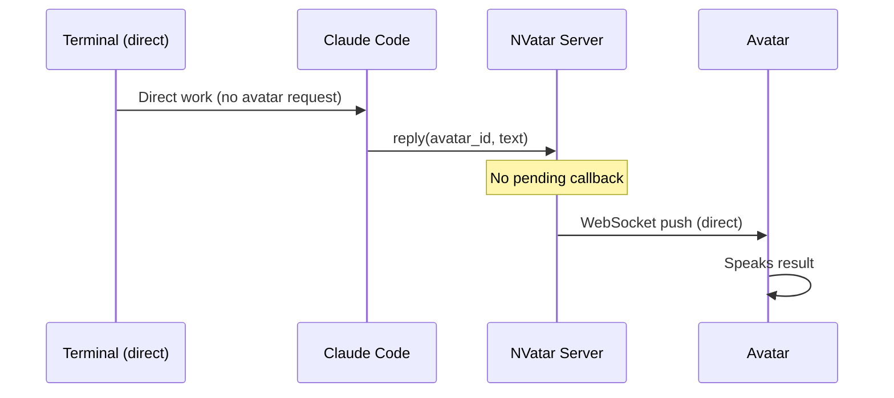
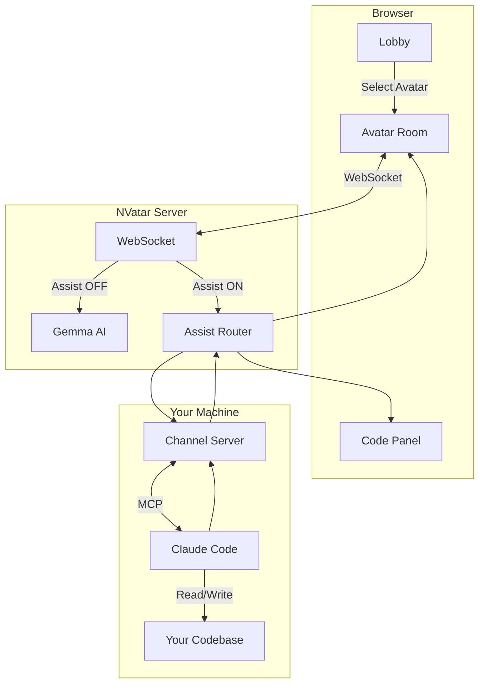
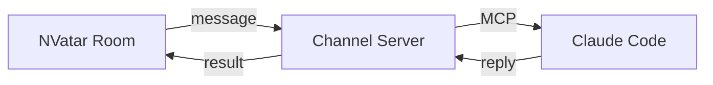

# NVatar Code Assist

> **你的3D AI虚拟形象变身代码助手 -- 由 Claude Code 驱动。**

NVatar Code Assist 把你的 [NVatar](https://github.com/nskit-io/nvatar-demo) 虚拟形象连接到本地的 [Claude Code](https://claude.ai/claude-code) 会话。向虚拟形象下达代码指令,Claude Code 就会在你的机器上执行。

[Live Demo（暂时下线）](https://nskit-io.github.io/nvatar-code-assist/) · [English](../README.md) · [한국어](README_KO.md) · [日本語](README_JA.md)

> **说明:** 演示服务器维护中,在线演示暂时下线。仍可从源码运行。
>
> **安全:** 托管页面**只是演示,不是生产端点**。它调用的 NVatar 服务器 API 本身没有用户认证,也不校验虚拟形象的归属。如自行部署,必须自己加上认证和服务器端归属校验,且不得直接暴露在公网上。详见[安全与配置](#安全与配置)。

---

## 工作原理



## 快速开始

### 准备

- [Claude Code](https://claude.ai/claude-code) v2.1.80 及以上
- [Bun](https://bun.sh/) 运行时

### Step 1: 克隆并安装

```bash
git clone https://github.com/nskit-io/nvatar-code-assist.git
cd nvatar-code-assist/channel
bun install
```

### Step 2: 打开大厅

访问 **[https://nskit-io.github.io/nvatar-code-assist/](https://nskit-io.github.io/nvatar-code-assist/)**



1. 点击 **Gen** 生成 Channel UUID
2. 复制下方显示的终端命令

### Step 3: 启动 Claude Code 通道

把复制的命令加上你所用 NVatar 服务器的地址,在终端中运行(大厅只显示 UUID 部分):

```bash
NVATAR_SERVER_URL=https://your-nvatar-server.example.com \
NVATAR_CHANNEL_UUID=<your-uuid> \
claude --dangerously-load-development-channels server:nvatar
```

> **重要:** 进入房间前先启动通道。没有 `NVATAR_SERVER_URL` 时通道无法注册(没有默认服务器)。详见[通道配置](#通道配置)。

### Step 4: 进入房间并切换 Assist

1. 在大厅选择虚拟形象并进入房间
2. 先和虚拟形象正常聊天(打招呼、设置名字等)
3. 准备做代码工作时,点击工具栏中的 **⚡ Assist**
4. 下达代码指令,Claude Code 就会执行

## 两种模式



### 普通模式(默认)

虚拟形象是对话型 AI 伙伴。它有性格、记忆和情感,并通过 TTS 说话。日常对话会被保存,虚拟形象会随时间成长。

### 代码助手模式(⚡ 开关)

消息会异步转发给 Claude Code — **没有超时**。虚拟形象会立即告知已受理,Claude Code 完成后结果送达:

| 操作 | 行为 |
|------|------|
| 你的消息 | 发送给 Claude Code → 虚拟形象提示"已经交给 Claude 了!" |
| 进度更新 | 虚拟形象实时播报 |
| 最终结果 | 虚拟形象朗读适合 TTS 的文本,Code Panel 显示原始数据 |
| 直接推送 | Claude Code 无需虚拟形象发起请求也能推送结果 |
| 询问虚拟形象的意见 | 虚拟形象结合结果上下文回答 |

> **Fire-and-forget**: 长任务也不会因超时失败。服务器确认 POST 送达后立即返回,结果通过异步推送到达。Claude Code 需要多久都可以。

**意见识别**支持4种语言 — 可以问虚拟形象对结果的看法:
- 🇰🇷 "어떻게 생각해?" · 🇺🇸 "What do you think?" · 🇯🇵 "どう思う?" · 🇨🇳 "你觉得怎么样?"

### 隐私

> **Code Assist 模式不会把对话保存到虚拟形象的记忆中。**

Code Assist 的结果保存在单独的 Code Panel 数据库中,而不是虚拟形象的 Franchise Memory。这由敏感数据模式的默认值 `save_franchise_memory = false` 控制。代码对话不会影响虚拟形象的性格,也不会成为其长期记忆的一部分。

| | 普通模式 | Code Assist 模式 |
|---|---|---|
| 对话记录 | 保存(塑造性格) | 不保存 |
| 情感追踪 | 启用 | 停用 |
| Franchise Memory | 随时间累积 | 停用(`save_franchise_memory = false`) |
| 代码结果 | — | 仅 Code Panel(独立存储) |

切换回普通模式后,虚拟形象会接着之前的对话继续。

## 适合 TTS 的响应拆分

当 Claude Code 返回包含表格、符号或格式化数据的结果时,响应会拆成两路:



| 字段 | 用途 | 示例 |
|------|------|------|
| `text` | 含表格、代码、符号的原始响应 | `\| Plan \| Price \| ...` |
| `tts_text` | 供虚拟形象朗读的自然语句 | "入门版每月5美元……" |

虚拟形象朗读适合 TTS 的版本,Code Panel 显示完整原始数据。若省略 `tts_text`,虚拟形象会像以前一样朗读原始文本(向后兼容)。

## 服务器推送(直接推送)

Claude Code 可以在**没有事先请求**的情况下把结果推送给虚拟形象。当你直接在终端里工作、又想让虚拟形象播报结果时:



这样就形成一种混合工作方式:直接在终端工作,虚拟形象同步了解情况并实时播报结果。

## 架构

Code Assist 以 `CodeAssistPattern` 实现 — 它是 [NVatar SDK](https://github.com/nskit-io/nvatar-sdk) 模式系统中的可插拔行为之一。SDK 的 BehaviorPattern Registry 按模式把消息路由到正确的模式,因此 Code Assist 独立于虚拟形象的性格引擎运行。



通道的 HTTP 监听绑定在 `127.0.0.1:8789`,因此 NVatar 服务器必须能访问该地址(在同一台机器上运行,或通过你自己管理的隧道)。

## Claude Code 通道

本项目使用 **Claude Code Channels** — 一种基于 MCP 的插件系统,让外部应用可以与 Claude Code 通信。



`channel/` 目录包含可直接使用的 MCP 服务器。运行启动命令时 Claude Code 会自动启动它,通道读取的设置见[通道配置](#通道配置)。

通道服务器对 MCP 通知投递内置自动重试(3次,间隔2秒),即使连接短暂不稳定,消息也能送达 Claude Code。

> 关于 Claude Code Channels 的更多信息,请参阅 [Claude Code 文档](https://docs.anthropic.com/en/docs/claude-code)。

## 可靠性

Code Assist 包含多层重试与错误处理:

| 层 | 行为 |
|----|------|
| **通道 → Claude Code** | MCP 通知重试(3次,间隔2秒) |
| **服务器 → 通道** | HTTP POST 重试(2次,间隔2秒) |
| **投递失败** | 简单的错误气泡 — 虚拟形象不会就失败编造回答 |
| **TTS 初始化** | `client_ready` 握手确保 TTS 初始化后虚拟形象才说话 |

重试后消息仍未送达 Claude Code 时,不会转交本地 AI(Gemma),而是显示简单的错误消息,以免虚拟形象对代码指令"编造"答案造成困惑。

## 安全与配置

### 托管演示与自建服务器

- GitHub Pages 上的页面固定调用本项目的演示服务器(`nvatar.nskit.io`,目前暂时下线)。它**只是演示,不是生产端点**。请勿通过它发送敏感代码或数据。
- 页面没有切换服务器 URL 的方式(没有 `server` URL 参数)。大厅(`index.html`)固定指向演示服务器(`SERVER` / `RES_SERVER` 常量);房间模块(`js/room/state.js`)在 `*.github.io` 上使用演示服务器,在其他主机上使用自身 origin。要使用自建的 NVatar 服务器,请从该服务器提供这些文件,并修改 `index.html` 中的两个常量。
- NVatar 服务器 API 本身没有**用户认证**,也没有**虚拟形象归属校验**。集成方必须在所有端点前加上认证,并在服务器端校验调用者确实拥有其指定的虚拟形象(`avatar` uid)和通道 UUID。

### 通道配置

通道读取以下环境变量(或 `~/.claude/channels/nvatar/.env` 中的行):

| 变量 | 默认值 | 说明 |
|------|--------|------|
| `NVATAR_CHANNEL_UUID` | 随机 | 必须与大厅生成的 UUID 一致 |
| `NVATAR_SERVER_URL` | 无(占位符) | 必填。你使用的 NVatar 服务器;缺少时注册失败 |
| `NVATAR_CHANNEL_SECRET` | 每次启动随机 | 服务器与通道之间的共享密钥。建议设为固定值,避免每次重启都生成新值 |
| `NVATAR_CHANNEL_PORT` | `8789` | 本地 HTTP 端口(绑定 `127.0.0.1`) |
| `NVATAR_STATE_DIR` | `~/.claude/channels/nvatar` | 读取 `.env` 文件的位置 |

### 通道连接的认证方式

1. 通道启动时向 NVatar 服务器注册(`/api/v1/channel/register`),并发送通道密钥(`X-Channel-Token` 请求头和请求体)。之后每30秒作为心跳重新注册。
2. 服务器向通道转发消息时(`127.0.0.1:8789` 上的 `POST /message`),必须在 `token` 字段中带上该密钥。不一致时以 **401** 拒绝。
3. 通道发往服务器的回调(`/api/v1/channel/callback`)也带同样的 `X-Channel-Token` 请求头。

该密钥只保护服务器与通道之间的连接。它不认证浏览器用户,也不证明虚拟形象归属 — 这些是集成方的责任(见上文)。

### CORS(仅当页面与服务器 origin 不同时)

从自建服务器提供页面时为同源,不需要 CORS。如果把客户端改为调用另一个 origin 的服务器,请只显式允许你自己的 origin — 不要用 `*`:

```python
# FastAPI
app.add_middleware(CORSMiddleware,
    allow_origins=["https://your-username.github.io"],  # explicit allowlist, never "*"
    allow_methods=["GET", "POST"],
    allow_headers=["Content-Type", "Authorization"])
```

## 服务与限制

| 服务 | 说明 |
|------|------|
| **NVatar 服务器** | 托管演示服务器因维护暂时下线,它只是演示,不是生产端点。自建服务器必须在前面加上认证与归属校验。 |
| **TTS(语音)** | 经 NVatar 服务器的云端 TTS。TTS 不可用时以文字气泡运行。 |
| **STT(麦克风输入)** | 需要自备 STT 端点:设置 `window.NVATAR_WHISPER_URL`(例如 `https://your-stt.example.com/api/v1/transcribe`)。未设置时麦克风停用,文字输入始终可用。 |

> 需要专属资源的企业部署,请[联系我们](mailto:nskit@nskit.io)。

## 故障排除

| 症状 | 解决方法 |
|------|----------|
| 向通道投递时返回 401 | 服务器保存的该通道密钥与通道当前密钥不一致(例如通道以新的随机密钥重启,尚未重新注册)。重启通道(启动时及每30秒重新注册),并将 `NVATAR_CHANNEL_SECRET` 设为固定值 |
| 通道日志: "NVATAR_SERVER_URL not set" | 将 `NVATAR_SERVER_URL` 设为你的 NVatar 服务器地址并重启通道 |
| 虚拟形象不转发指令 | 点击 **⚡ Assist** 开启 Code Assist 模式 |
| "서버 연결 대기 중"(等待服务器连接) | 刷新页面 — 服务器可能正在加载 |
| 刷新后代码面板为空 | 确认使用的是同一个 Channel UUID |
| TTS 不工作 | 浏览器自动播放策略 — 先与页面交互 |
| 通道无法连接 | 用同一个 UUID 和正确的 `NVATAR_SERVER_URL` 重启 Claude Code |
| 说话时虚拟形象不回到中央 | 已修复 — 每次气泡事件都会调用 `returnToCenter()` |
| TTS 就绪前虚拟形象就说话 | 已修复 — `client_ready` 握手会把问候推迟到场景加载之后 |
| 消息投递失败却无提示 | 服务器以2秒间隔重试2次,最终失败时显示错误 |

## 项目结构

```
nvatar-code-assist/
├── index.html              # Lobby — 选择虚拟形象
├── code-assist.html        # Room — 3D 虚拟形象 + 聊天 + 代码面板
├── js/room/                # Room 模块(16个文件)
│   ├── main-assist.js      # 代码助手开关逻辑
│   ├── chat.js             # WebSocket + 代码面板
│   ├── i18n.js             # 4种语言翻译
│   └── ...                 # scene, animation, tts, stt, mood 等
├── vrm/
│   ├── models.json         # 虚拟形象模型列表
│   └── thumbnails/         # 虚拟形象缩略图
├── channel/
│   ├── server.ts           # MCP 通道服务器(Bun)
│   └── package.json
└── docs/                   # 翻译版 README(KO, JA, ZH)
```

## NVatarSDK API

面向与房间集成的开发者:

```javascript
// Subscribe to code results
NVatarSDK.onLookupResult = (data) => { ... };

// Read stored results
NVatarSDK.getLookupResults();
NVatarSDK.getUnreadCount();
NVatarSDK.clearLookupResults();
```

## 相关项目

| 项目 | 说明 |
|------|------|
| [NVatar Demo](https://github.com/nskit-io/nvatar-demo) | AI 3D 虚拟形象聊天平台 — 虚拟形象运行时 |
| [NVatar SDK](https://github.com/nskit-io/nvatar-sdk) | BehaviorPattern SDK — 构建可插拔的虚拟形象服务 |

## 许可证

CC BY-NC-SA 4.0 — 参见 [LICENSE](../LICENSE)

---

Built with [NVatar](https://github.com/nskit-io/nvatar-demo) and [NVatar SDK](https://github.com/nskit-io/nvatar-sdk) — AI 3D Avatar Chat Platform
